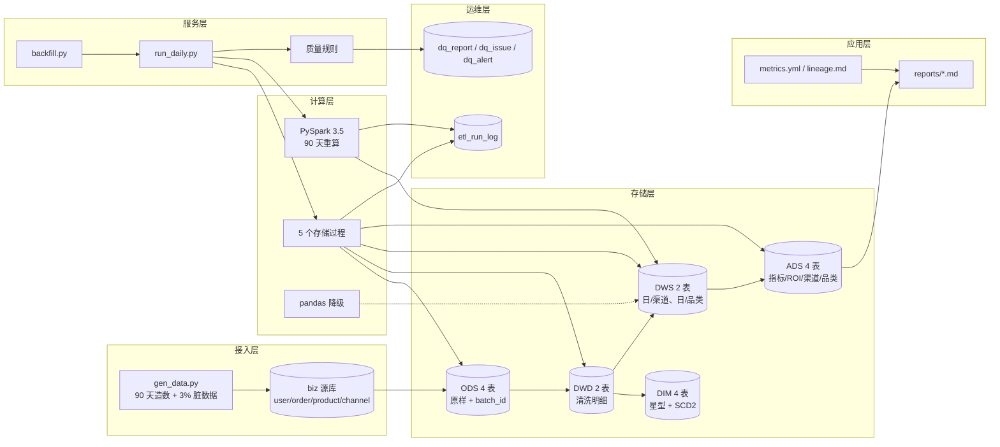
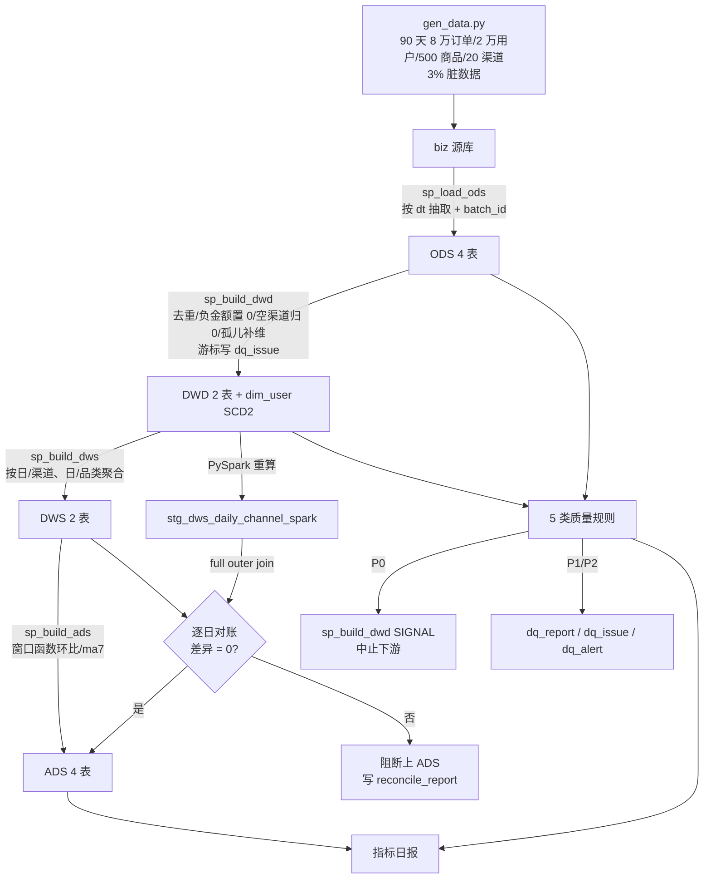
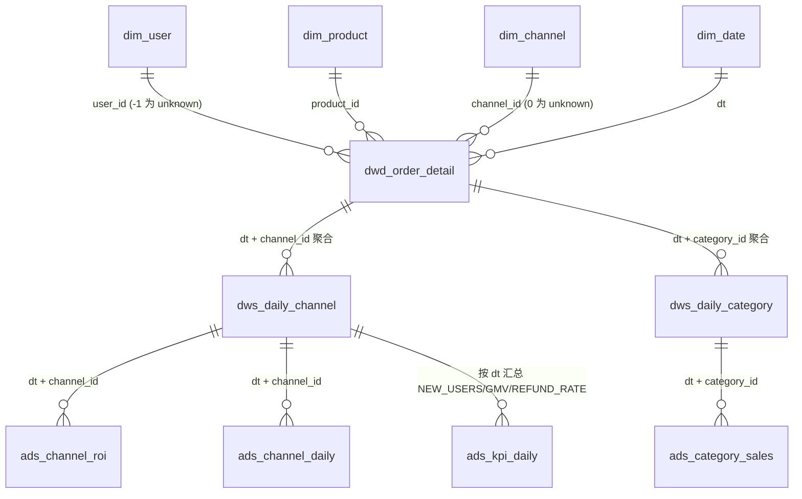
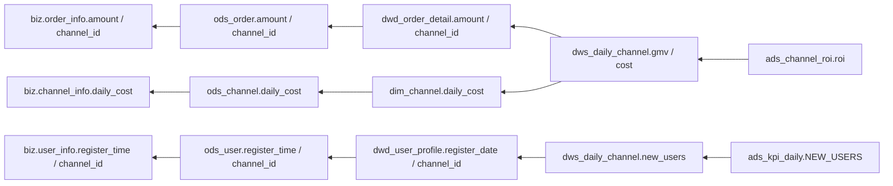

# 第一轮技术架构设计文档 · dw-etl-pipeline

> 第 2 步产物（资深软件架构师）。输入：`01_项目基线说明书.md`（全量）+ `00_原始项目描述.md`（设计书 §3/§4/§11）。
> 本文档是第 3 步架构评审、第 4 步任务拆解、第 5A 步实现的唯一架构基准；偏离须回流第 2 步。
> 版本：v1.1（2026-11-23，第一轮评审后修订）｜路线：生产｜接口形态：非 HTTP（SQL 存储过程 + CLI + 数据表）
> v1.1 修订项：补「跳过层需校验目标行数」、补 §11.1 指标测量口径、ADS 补 `aov`/`cac`/`refund_amount` 字段、slow log 补 `log_output=TABLE`、R-01 补内存预检结论。

---

## 0. 开工前看板复核（只读，不重新判断）

| 看板项 | 取值 | 是否带「用户未确认」 | 本步处置 |
|---|---|---|---|
| 项目类型 | internal-tool | 是 | 决策点①（G9 门面页方向稿）**不触发**：internal-tool 无展示门面，ADS 只出表与报告 |
| 设计模式 | 普通 | 是 | 决策点②（§ 前端设计方向）**整段跳过**：本项目无前端页面 |
| 是否录 demo 视频 | 否 | 是 | 不产出 demo 脚本，第 9 步按命令行走查 |

三项均未被用户中途改值，无回补产物。若用户后续把「设计模式」改为精修，本项目无前端，仍不触发视觉精修链路，只回补说明。

---

## 1. 技术选型

### 1.1 选型总表

| 组件 | 版本 | 用途 | 选型理由 | 兼容性 / 约束 |
|---|---|---|---|---|
| MySQL | 8.0.36（Docker `mysql:8.0.36`） | 源库 `biz` + 数仓库 `dw` | 需要窗口函数、CTE、`ROW_NUMBER`、`SIGNAL`、`DECLARE HANDLER`、`GET_LOCK`；8.0 才齐 | 容器映射宿主 **53306**；`utf8mb4_0900_ai_ci`；`--default-time-zone=+08:00` |
| Python | 3.11.9（本机已装） | 造数、编排、质量规则、对账、测试 | 基线技术栈约束；3.11 与 PySpark 3.5、pandas 2.2 兼容 | `py -3.11` 启动；虚拟环境 `.venv` |
| PyMySQL | 1.1.1 | MySQL 驱动 | 纯 Python，Windows 免编译；避开 `mysqlclient` 的 MSVC 构建依赖 | 支持 MySQL 8 的 `caching_sha2_password` |
| SQLAlchemy | 2.0.36 | 连接管理、事务、参数化 SQL | 2.0 风格 `text()` + `engine.begin()`，避免手写连接池 | 与 PyMySQL 1.1.1 兼容 |
| pandas | 2.2.3 | 对账、报告、Spark 降级通道 | 90 天聚合量级小；分块读写可控制内存 | 需 Python ≥3.9；numpy 由 pip 解析 |
| PySpark | 3.5.3 | 90 天 DWS 重算与对账 | 设计书指定的加分项；3.5 支持 Python 3.8–3.11 | 需 Java 17（本机 Temurin 17.0.19 已装）；Windows 需 winutils 风险见 §8 |
| PyYAML | 6.0.2 | `metrics.yml` / `dq_rules.yml` 解析 | 治理配置与代码分离，便于评审 | 纯 Python |
| python-dotenv | 1.0.1 | 读取 `.env` 数据库连接 | 密钥/口令不入库不入仓 | `.env` 进 `.gitignore` |
| pytest | 8.3.3 | ≥20 条测试 | 基线 C09 明确要求 | 与 SQLAlchemy 组合做 SQL 断言 |
| Docker Compose | v5.1.4（本机） | 一键起 MySQL | C10 要求 `docker compose up` 可复跑 | 仅 MySQL 一个服务，不引入其他中间件 |
| Java | Temurin 17.0.19（本机） | Spark 运行时 | Spark 3.5 官方支持 Java 8/11/17 | 不额外装 JDK 8/11 |

### 1.2 明确不引入

- **Airflow / DolphinScheduler**：单机 `run_daily.py` + Windows 任务计划/cron 已能证明依赖与重试；上平台是运维量级，不是能力增量（基线排除范围）。
- **Hadoop / HDFS / YARN / Flink / Kafka**：16GB 内存无真实集群价值；只做原理对照，不伪称集群经验。
- **Faker**：造数用标准库 `random` + 固定种子，保证可复现，少一个依赖。
- **Java 后端骨架**：Java 能力由既有 #6/#2 覆盖，本项目不新建 Spring Boot。
- **BI / 大屏前端**：ADS 只出表、指标字典与报告，不做页面。

### 1.3 版本兼容性说明

- Spark 3.5.3 官方支持 Python 3.8–3.11；本机 3.11.9 在支持区间内。
- pandas 2.2.3 要求 Python ≥3.9、numpy ≥1.22；由 pip 解析到兼容版本。
- SQLAlchemy 2.0.36 + PyMySQL 1.1.1 组合支持 MySQL 8 默认认证插件；连接串固定 `mysql+pymysql://...?charset=utf8mb4`。
- 所有 Python 依赖已在 `requirements.txt` 固定版本，G4 可解性校验见 §12。
- Spark 在 Windows 下写本地文件可能需要 `winutils.exe`/`hadoop.dll`；本项目 Spark 只经 JDBC 读写 MySQL、不写 HDFS，若仍报 winutils 错误，按 §8 风险 R-03 处置（装 winutils 或走 pandas 降级）。

---

## 2. 整体分层架构

> 本项目无 HTTP 服务，按「接入 → 存储 → 计算 → 服务 → 应用 → 运维」六层落地；「服务层」是 CLI/存储过程编排，不是 Web 服务。

| 层 | 职责 | 组件 / 对象 | 明确不做 |
|---|---|---|---|
| 接入层 | 把模拟业务数据写入源库；ODS 按日抽取 | `biz` 库 4 张源表；`scripts/gen_data.py`（90 天、固定种子、3% 脏数据）；`sp_load_ods` 的 `INSERT ... SELECT` | 不接真实业务库、不做 CDC/binlog 实时抽取 |
| 存储层 | 四层数据 + 维表 + 元数据/治理表 | `dw` 库：`ods_*` 4 张、`dwd_*` 2 张、`dim_*` 4 张、`dws_*` 2 张、`ads_*` 4 张、`etl_run_log` / `dq_report` / `dq_issue` / `dq_alert` | 不引入列存/MPP；不建 Hive 元仓 |
| 计算层 | 清洗、聚合、指标计算、批重算 | 5 个 MySQL 存储过程；PySpark 3.5 作业；pandas 降级脚本 | 不做流计算；不做跨库联邦查询 |
| 服务层 | 按日编排、参数校验、失败重试、对账触发 | `scripts/run_daily.py`、`scripts/backfill.py`、`sp_etl_daily` 调用契约、退出码协议 | 不暴露 HTTP/RPC 接口（6.5 OpenAPI 自动跳过） |
| 应用层 | 面向「老板 9 点看数」的交付物 | ADS 4 张表；`reports/` 下的指标日报、质量报告、对账报告、性能报告；`governance/metrics.yml` + `lineage.md` | 不做图表页面、不做导出 Excel 服务 |
| 运维层 | 运行留痕、质量拦截、慢查询取证、部署 | `etl_run_log`、`dq_alert`、MySQL slow log、`ops.md`、`docker-compose.yml`、`.env` | 不上 Prometheus/Grafana；不做多节点高可用 |

### 2.1 架构图



---

## 3. 核心业务链路（端到端输入 / 处理 / 输出）

### L1 分层建模与维度建模

- **输入**：`biz` 4 张源表（模拟数据）。
- **处理**：`sql/init/` 建库建表；ODS 原样落库并打 `batch_id`/`load_time`；DWD 做清洗、去重、类型统一、维表关联；`dim_user` 按会员等级/城市变化维护 SCD2；`dim_date` 预生成 2026-01-01～2027-12-31。
- **输出**：四层表 + 每张表的粒度说明（见 §4.1）+ 分层行数可核对。
- **失败点**：DDL 顺序错、分区缺省、维表未先灌导致孤儿；由 `sql/init` 固定执行顺序与 `dim_*` 先灌解决。

### L2 存储过程 ETL 主链路

- **输入**：`p_date`（业务日期，`DATE`）、`p_batch_id`。
- **处理**：`sp_etl_daily` 先取 `GET_LOCK`，逐层查 `etl_run_log`，已成功层跳过；未成功层依次调用 `sp_load_ods → sp_build_dwd → sp_build_dws → sp_build_ads`；每层独立事务，异常回滚本层并写 failed。
- **输出**：`p_status`（success/skipped/blocked）、`p_rows`（本层写出行数）、`etl_run_log` 记录、四层数据。
- **失败点**：源表名错误、主键冲突、DQ P0；异常码写 `error_code`，修复后从失败层重跑（C08）。

### L3 Spark 90 天重算与对账

- **输入**：DWD 90 天分区、`dim_*` 维表。
- **处理**：JDBC 读 DWD → 广播小维表 → 窗口去重 → `fillna` 补空 → 按日/渠道（及品类）聚合 → 写 `stg_dws_*_spark` → 与存储过程结果 `full outer join` 逐日对账。
- **输出**：`stg_dws_*_spark`、`reports/reconcile_report.md`、`etl_run_log(layer='RECONCILE')`；差异必须为 0（C05）。
- **失败点**：Spark OOM、Windows winutils、JDBC 时区；降级 pandas 并在报告写明（基线配套范围①）。

### L4 指标、血缘与质量治理

- **输入**：DWD/DWS/ADS 数据 + `metrics.yml` + `dq_rules.yml`。
- **处理**：`sp_build_ads` 算一级指标与环比/7 日均值；Python 质量引擎复跑 5 类规则并写 `dq_report`/`dq_issue`/`dq_alert`；P0 在 `sp_build_dwd` 内 `SIGNAL` 阻断下游。
- **输出**：ADS 4 张表、`reports/dq_report.md`、`governance/metrics.yml`、`governance/lineage.md`。
- **失败点**：口径不一致、P0 阈值误伤正常脏数据；阈值与处置见 §6.4。

### L5 查询性能优化

- **输入**：3 条典型慢查询 SQL。
- **处理**：`EXPLAIN ANALYZE` 取优化前基线 → 加索引/改写法/窗口函数/预聚合 → 复测 5 次取中位数 → slow log 佐证。
- **输出**：`reports/perf_report.md`（前后耗时、执行计划关键行、提升倍数）。
- **失败点**：小数据量下提升不足 3 倍；按基线配套范围③至少 2 条达标，其余如实记录。

### L6 调度、运维与部署

- **输入**：`--date` 或 `--start/--end`。
- **处理**：`run_daily.py` 串联造数增量 → 质量预检 → 存储过程 → Spark 重算（可选）→ 质量复跑 → 报告；失败退出码非 0；`etl_run_log` 记录批次/层/起止/行数/状态/错误。
- **输出**：可一键复跑；`ops.md` 5 类异常排查手册；`docker compose up` 起 MySQL。
- **失败点**：端口占用、容器未健康、时区错位；见 §9 与 `ops.md`。

### L7 数据流总图（端到端）



---

## 4. 数据模型设计

### 4.1 分层与粒度规范

| 层 | 表 | 一行代表什么（粒度） | 只依赖 | 更新方式 |
|---|---|---|---|---|
| 源库 biz | `user_info` / `order_info` / `product_info` / `channel_info` | 一个业务实体（订单为一次下单） | 无 | 造数脚本写入 |
| ODS | `ods_user` | 一个用户在一个 ETL 日期被抽取到的一次记录 | biz | 按 `(user_id, dt)` 重写 |
| ODS | `ods_order` | 一个订单在一个 ETL 日期被抽取到的一次记录 | biz | 按 `(order_no, dt)` 重写 |
| ODS | `ods_product` / `ods_channel` | 一个商品/渠道在某个 `dt` 的当日快照 | biz | 按 `(id, dt)` 重写 |
| DWD | `dwd_order_detail` | 一个订单号在一个业务日期的一条（去重后）明细 | ODS + 维表 | 按 `dt` 删除后重写 |
| DWD | `dwd_user_profile` | 一个用户的最新画像（每用户一行） | ODS | 按 `user_id` upsert |
| DIM | `dim_user` | 一个用户的一段会员等级/城市有效期（SCD2 版本） | DWD | 版本关闭 + 新版本插入 |
| DIM | `dim_product` / `dim_channel` | 一个商品/渠道的当前属性 | ODS | 按业务主键 upsert |
| DIM | `dim_date` | 一个自然日 | 预生成 | 静态初始化 |
| DWS | `dws_daily_channel` | 一天 × 一个渠道的经营聚合 | DWD + DIM | `(dt, channel_id)` 唯一键 upsert |
| DWS | `dws_daily_category` | 一天 × 一个品类的销售聚合 | DWD + DIM | `(dt, category_id)` 唯一键 upsert |
| ADS | `ads_kpi_daily` | 一天 × 一个一级指标（不按渠道拆） | DWS | `(dt, kpi_code)` upsert |
| ADS | `ads_channel_roi` | 一天 × 一个渠道的 ROI 视图 | DWS + DIM | `(dt, channel_id)` upsert |
| ADS | `ads_channel_daily` | 一天 × 一个渠道的经营日报视图 | DWS | `(dt, channel_id)` upsert |
| ADS | `ads_category_sales` | 一天 × 一个品类的销售视图 | DWS | `(dt, category_id)` upsert |

### 4.2 源表 DDL（`sql/init/02_biz.sql`）

```sql
CREATE DATABASE IF NOT EXISTS biz DEFAULT CHARACTER SET utf8mb4 COLLATE utf8mb4_0900_ai_ci;
USE biz;

CREATE TABLE IF NOT EXISTS user_info (
  user_id       BIGINT       NOT NULL COMMENT '用户业务主键',
  user_name     VARCHAR(64)  NOT NULL,
  phone         VARCHAR(20)  NULL,
  city          VARCHAR(32)  NULL,
  level         TINYINT      NOT NULL DEFAULT 1 COMMENT '1 普通 2 银卡 3 金卡',
  channel_id    INT          NULL COMMENT '注册来源渠道，用于按渠道统计新增',
  register_time DATETIME     NOT NULL,
  update_time   DATETIME     NOT NULL,
  PRIMARY KEY (user_id),
  KEY idx_register_time (register_time),
  KEY idx_update_time (update_time)
) ENGINE=InnoDB DEFAULT CHARSET=utf8mb4 COMMENT='模拟用户源表';

CREATE TABLE IF NOT EXISTS product_info (
  product_id    BIGINT       NOT NULL,
  product_name  VARCHAR(128) NOT NULL,
  category_id   INT          NOT NULL,
  category_name VARCHAR(64)  NOT NULL,
  price         DECIMAL(12,2) NOT NULL,
  status        TINYINT      NOT NULL DEFAULT 1 COMMENT '1 在售 0 下架',
  update_time   DATETIME     NOT NULL,
  PRIMARY KEY (product_id),
  KEY idx_category (category_id)
) ENGINE=InnoDB DEFAULT CHARSET=utf8mb4 COMMENT='模拟商品源表';

CREATE TABLE IF NOT EXISTS channel_info (
  channel_id   INT          NOT NULL,
  channel_name VARCHAR(64)  NOT NULL,
  channel_type VARCHAR(32)  NOT NULL COMMENT 'search/social/display/offline',
  daily_cost   DECIMAL(12,2) NOT NULL DEFAULT 0.00 COMMENT '模拟日投放成本，ROI 分母',
  status       TINYINT      NOT NULL DEFAULT 1,
  update_time  DATETIME     NOT NULL,
  PRIMARY KEY (channel_id)
) ENGINE=InnoDB DEFAULT CHARSET=utf8mb4 COMMENT='模拟渠道源表';

CREATE TABLE IF NOT EXISTS order_info (
  order_id    BIGINT       NOT NULL,
  order_no    VARCHAR(32)  NOT NULL,
  user_id     BIGINT       NOT NULL,
  product_id  BIGINT       NOT NULL,
  channel_id  INT          NULL COMMENT '允许为空，模拟空渠道脏数据',
  quantity    INT          NOT NULL DEFAULT 1,
  amount      DECIMAL(12,2) NOT NULL COMMENT '允许为负，模拟金额越界脏数据',
  status      VARCHAR(16)  NOT NULL COMMENT 'paid/refunded/cancelled',
  pay_time    DATETIME     NOT NULL,
  refund_time DATETIME     NULL,
  update_time DATETIME     NOT NULL,
  PRIMARY KEY (order_id),
  KEY idx_order_no (order_no),
  KEY idx_pay_time (pay_time),
  KEY idx_user (user_id),
  KEY idx_channel (channel_id)
) ENGINE=InnoDB DEFAULT CHARSET=utf8mb4 COMMENT='模拟订单源表';
```

> 说明：源库**故意不建 `order_no` 唯一键**，允许不同 `order_id` 携带相同 `order_no`，用于制造「重复订单」脏数据；ODS 以 `(order_id, dt)` 保留原样，DWD 再按 `order_no` 去重并写 `dq_issue`。若源库建了唯一键，去重规则就没有真实输入，C04 无法验证。

### 4.3 ODS 层 DDL（`sql/init/03_dw_ods.sql`）

```sql
CREATE DATABASE IF NOT EXISTS dw DEFAULT CHARACTER SET utf8mb4 COLLATE utf8mb4_0900_ai_ci;
USE dw;

CREATE TABLE IF NOT EXISTS ods_user (
  ods_id        BIGINT      NOT NULL AUTO_INCREMENT,
  user_id       BIGINT      NOT NULL,
  user_name     VARCHAR(64) NULL,
  phone         VARCHAR(20) NULL,
  city          VARCHAR(32) NULL,
  level         TINYINT     NULL,
  channel_id    INT         NULL,
  register_time DATETIME    NULL,
  update_time   DATETIME    NULL,
  dt            DATE        NOT NULL,
  batch_id      VARCHAR(32) NOT NULL,
  load_time     DATETIME    NOT NULL DEFAULT CURRENT_TIMESTAMP,
  PRIMARY KEY (ods_id),
  UNIQUE KEY uk_user_dt (user_id, dt),
  KEY idx_dt (dt),
  KEY idx_batch (batch_id)
) ENGINE=InnoDB DEFAULT CHARSET=utf8mb4 COMMENT='ODS 用户，一行=一个用户在一次 ETL 日期的抽取';

CREATE TABLE IF NOT EXISTS ods_order (
  ods_id      BIGINT      NOT NULL AUTO_INCREMENT,
  order_id    BIGINT      NOT NULL,
  order_no    VARCHAR(32) NOT NULL,
  user_id     BIGINT      NOT NULL,
  product_id  BIGINT      NOT NULL,
  channel_id  INT         NULL,
  quantity    INT         NULL,
  amount      DECIMAL(12,2) NULL,
  status      VARCHAR(16) NULL,
  pay_time    DATETIME    NULL,
  refund_time DATETIME    NULL,
  update_time DATETIME    NULL,
  dt          DATE        NOT NULL,
  batch_id    VARCHAR(32) NOT NULL,
  load_time   DATETIME    NOT NULL DEFAULT CURRENT_TIMESTAMP,
  PRIMARY KEY (ods_id),
  UNIQUE KEY uk_order_id_dt (order_id, dt),
  KEY idx_order_no (order_no),
  KEY idx_dt (dt),
  KEY idx_channel (channel_id)
) ENGINE=InnoDB DEFAULT CHARSET=utf8mb4 COMMENT='ODS 订单，一行=一个订单在一次 ETL 日期的抽取';

CREATE TABLE IF NOT EXISTS ods_product (
  ods_id        BIGINT      NOT NULL AUTO_INCREMENT,
  product_id    BIGINT      NOT NULL,
  product_name  VARCHAR(128) NULL,
  category_id   INT         NULL,
  category_name VARCHAR(64) NULL,
  price         DECIMAL(12,2) NULL,
  status        TINYINT     NULL,
  update_time   DATETIME    NULL,
  dt            DATE        NOT NULL,
  batch_id      VARCHAR(32) NOT NULL,
  load_time     DATETIME    NOT NULL DEFAULT CURRENT_TIMESTAMP,
  PRIMARY KEY (ods_id),
  UNIQUE KEY uk_product_dt (product_id, dt),
  KEY idx_dt (dt)
) ENGINE=InnoDB DEFAULT CHARSET=utf8mb4 COMMENT='ODS 商品日快照';

CREATE TABLE IF NOT EXISTS ods_channel (
  ods_id       BIGINT      NOT NULL AUTO_INCREMENT,
  channel_id   INT         NOT NULL,
  channel_name VARCHAR(64) NULL,
  channel_type VARCHAR(32) NULL,
  daily_cost   DECIMAL(12,2) NULL,
  status       TINYINT     NULL,
  update_time  DATETIME    NULL,
  dt           DATE        NOT NULL,
  batch_id     VARCHAR(32) NOT NULL,
  load_time    DATETIME    NOT NULL DEFAULT CURRENT_TIMESTAMP,
  PRIMARY KEY (ods_id),
  UNIQUE KEY uk_channel_dt (channel_id, dt),
  KEY idx_dt (dt)
) ENGINE=InnoDB DEFAULT CHARSET=utf8mb4 COMMENT='ODS 渠道日快照';
```

### 4.4 DWD 与维表 DDL（`sql/init/04_dw_dwd_dim.sql`）

```sql
USE dw;

CREATE TABLE IF NOT EXISTS dwd_order_detail (
  order_detail_id BIGINT      NOT NULL AUTO_INCREMENT,
  dt              DATE        NOT NULL,
  order_no        VARCHAR(32) NOT NULL,
  order_id        BIGINT      NOT NULL,
  user_id         BIGINT      NOT NULL COMMENT '孤儿用户统一置 -1',
  product_id      BIGINT      NOT NULL,
  category_id     INT         NOT NULL DEFAULT 0,
  channel_id      INT         NOT NULL DEFAULT 0 COMMENT '空渠道统一置 0(unknown)',
  quantity        INT         NOT NULL DEFAULT 1,
  amount          DECIMAL(12,2) NOT NULL DEFAULT 0.00 COMMENT '负值已置 0',
  order_status    VARCHAR(16) NOT NULL DEFAULT 'paid' COMMENT 'paid/refunded/cancelled',
  is_refund       TINYINT     NOT NULL DEFAULT 0,
  pay_time        DATETIME    NULL,
  refund_time     DATETIME    NULL,
  dq_flag         INT         NOT NULL DEFAULT 0 COMMENT '位标记:1 负金额 2 空渠道 4 孤儿用户 8 重复去重',
  batch_id        VARCHAR(32) NULL,
  etl_time        DATETIME    NOT NULL DEFAULT CURRENT_TIMESTAMP,
  PRIMARY KEY (order_detail_id, dt),
  UNIQUE KEY uk_dt_order_no (dt, order_no),
  KEY idx_dt_channel (dt, channel_id),
  KEY idx_dt_user (dt, user_id),
  KEY idx_dt_category (dt, category_id),
  KEY idx_dt_channel_amount (dt, channel_id, is_refund, amount)
) ENGINE=InnoDB DEFAULT CHARSET=utf8mb4 COMMENT='订单明细事实表，一行=一个订单号在一个业务日期的去重明细'
PARTITION BY RANGE COLUMNS(dt) (
  PARTITION p202606 VALUES LESS THAN ('2026-07-01'),
  PARTITION p202607 VALUES LESS THAN ('2026-08-01'),
  PARTITION p202608 VALUES LESS THAN ('2026-09-01'),
  PARTITION p202609 VALUES LESS THAN ('2026-10-01'),
  PARTITION p202610 VALUES LESS THAN ('2026-11-01'),
  PARTITION p202611 VALUES LESS THAN ('2026-12-01'),
  PARTITION p202612 VALUES LESS THAN ('2027-01-01'),
  PARTITION p202701 VALUES LESS THAN ('2027-02-01'),
  PARTITION p202702 VALUES LESS THAN ('2027-03-01'),
  PARTITION pmax    VALUES LESS THAN (MAXVALUE)
);

CREATE TABLE IF NOT EXISTS dwd_user_profile (
  user_id          BIGINT      NOT NULL,
  user_name        VARCHAR(64) NULL,
  city             VARCHAR(32) NULL,
  level            TINYINT     NOT NULL DEFAULT 1,
  channel_id       INT         NOT NULL DEFAULT 0,
  register_time    DATETIME    NULL,
  register_date    DATE        NULL,
  last_update_time DATETIME    NULL,
  is_orphan        TINYINT     NOT NULL DEFAULT 0,
  batch_id         VARCHAR(32) NULL,
  etl_time         DATETIME    NOT NULL DEFAULT CURRENT_TIMESTAMP,
  PRIMARY KEY (user_id),
  KEY idx_register_date (register_date),
  KEY idx_level (level),
  KEY idx_channel (channel_id)
) ENGINE=InnoDB DEFAULT CHARSET=utf8mb4 COMMENT='用户明细宽表，一行=一个用户最新画像';

CREATE TABLE IF NOT EXISTS dim_user (
  user_sk    BIGINT      NOT NULL AUTO_INCREMENT,
  user_id    BIGINT      NOT NULL,
  user_name  VARCHAR(64) NULL,
  level      TINYINT     NOT NULL,
  city       VARCHAR(32) NULL,
  channel_id INT         NOT NULL DEFAULT 0,
  start_date DATE        NOT NULL,
  end_date   DATE        NOT NULL DEFAULT '9999-12-31',
  is_current TINYINT     NOT NULL DEFAULT 1,
  version    INT         NOT NULL DEFAULT 1,
  batch_id   VARCHAR(32) NULL,
  PRIMARY KEY (user_sk),
  UNIQUE KEY uk_user_start (user_id, start_date),
  KEY idx_user_current (user_id, is_current),
  KEY idx_current (is_current)
) ENGINE=InnoDB DEFAULT CHARSET=utf8mb4 COMMENT='用户维表 SCD2，一行=一个用户的一段等级/城市有效期';

CREATE TABLE IF NOT EXISTS dim_product (
  product_id    BIGINT      NOT NULL,
  product_name  VARCHAR(128) NULL,
  category_id   INT         NOT NULL DEFAULT 0,
  category_name VARCHAR(64) NULL,
  price         DECIMAL(12,2) NOT NULL DEFAULT 0.00,
  status        TINYINT     NOT NULL DEFAULT 1,
  PRIMARY KEY (product_id),
  KEY idx_category (category_id)
) ENGINE=InnoDB DEFAULT CHARSET=utf8mb4 COMMENT='商品维表';

CREATE TABLE IF NOT EXISTS dim_channel (
  channel_id   INT         NOT NULL,
  channel_name VARCHAR(64) NOT NULL,
  channel_type VARCHAR(32) NULL,
  daily_cost   DECIMAL(12,2) NOT NULL DEFAULT 0.00,
  status       TINYINT     NOT NULL DEFAULT 1,
  PRIMARY KEY (channel_id)
) ENGINE=InnoDB DEFAULT CHARSET=utf8mb4 COMMENT='渠道维表，channel_id=0 为 unknown';

CREATE TABLE IF NOT EXISTS dim_date (
  dt         DATE     NOT NULL,
  year       SMALLINT NOT NULL,
  quarter    TINYINT  NOT NULL,
  month      TINYINT  NOT NULL,
  day        TINYINT  NOT NULL,
  week       TINYINT  NOT NULL,
  weekday    TINYINT  NOT NULL COMMENT '1=周一 … 7=周日',
  is_weekend TINYINT  NOT NULL,
  PRIMARY KEY (dt)
) ENGINE=InnoDB DEFAULT CHARSET=utf8mb4 COMMENT='日期维表，2026-01-01～2027-12-31';
```

**SCD2 维护规则（`sp_build_dwd` 内）**：

1. 对 `dwd_user_profile` 中 `level` 或 `city` 与 `dim_user` 当前版本不一致的用户：
   - 关闭旧版本：`end_date = DATE_SUB(p_date, INTERVAL 1 DAY)`、`is_current = 0`；
   - 插入新版本：`start_date = p_date`、`end_date = '9999-12-31'`、`is_current = 1`、`version = 旧版本 + 1`。
2. 新用户：直接插入 `version=1` 的当前版本。
3. 唯一键 `(user_id, start_date)` 保证同日重跑不产生重复版本；重跑时先按 `(user_id, start_date=p_date)` 覆盖当日新版本。
4. 初始化必灌两条特殊维记录：`dim_user(user_id=-1, level=0, city='unknown')`、`dim_channel(channel_id=0, channel_name='unknown')`。

### 4.5 DWS 层 DDL（`sql/init/05_dw_dws_ads.sql`）

```sql
USE dw;

CREATE TABLE IF NOT EXISTS dws_daily_channel (
  dt            DATE        NOT NULL,
  channel_id    INT         NOT NULL,
  new_users     INT         NOT NULL DEFAULT 0,
  orders        INT         NOT NULL DEFAULT 0,
  paid_orders   INT         NOT NULL DEFAULT 0,
  gmv           DECIMAL(14,2) NOT NULL DEFAULT 0.00,
  refund_orders INT         NOT NULL DEFAULT 0,
  refund_amount DECIMAL(14,2) NOT NULL DEFAULT 0.00,
  refund_rate   DECIMAL(6,4)  NOT NULL DEFAULT 0.0000,
  cost          DECIMAL(14,2) NOT NULL DEFAULT 0.00,
  roi           DECIMAL(10,4) NOT NULL DEFAULT 0.0000,
  batch_id      VARCHAR(32) NULL,
  etl_time      DATETIME    NOT NULL DEFAULT CURRENT_TIMESTAMP,
  PRIMARY KEY (dt, channel_id),
  KEY idx_channel_dt (channel_id, dt)
) ENGINE=InnoDB DEFAULT CHARSET=utf8mb4 COMMENT='日/渠道聚合，一行=一天一个渠道'
PARTITION BY RANGE COLUMNS(dt) (
  PARTITION p202606 VALUES LESS THAN ('2026-07-01'),
  PARTITION p202607 VALUES LESS THAN ('2026-08-01'),
  PARTITION p202608 VALUES LESS THAN ('2026-09-01'),
  PARTITION p202609 VALUES LESS THAN ('2026-10-01'),
  PARTITION p202610 VALUES LESS THAN ('2026-11-01'),
  PARTITION p202611 VALUES LESS THAN ('2026-12-01'),
  PARTITION p202612 VALUES LESS THAN ('2027-01-01'),
  PARTITION p202701 VALUES LESS THAN ('2027-02-01'),
  PARTITION p202702 VALUES LESS THAN ('2027-03-01'),
  PARTITION pmax    VALUES LESS THAN (MAXVALUE)
);

CREATE TABLE IF NOT EXISTS dws_daily_category (
  dt            DATE        NOT NULL,
  category_id   INT         NOT NULL,
  category_name VARCHAR(64) NULL,
  orders        INT         NOT NULL DEFAULT 0,
  paid_orders   INT         NOT NULL DEFAULT 0,
  gmv           DECIMAL(14,2) NOT NULL DEFAULT 0.00,
  refund_orders INT         NOT NULL DEFAULT 0,
  refund_amount DECIMAL(14,2) NOT NULL DEFAULT 0.00,
  refund_rate   DECIMAL(6,4)  NOT NULL DEFAULT 0.0000,
  batch_id      VARCHAR(32) NULL,
  etl_time      DATETIME    NOT NULL DEFAULT CURRENT_TIMESTAMP,
  PRIMARY KEY (dt, category_id),
  KEY idx_category_dt (category_id, dt)
) ENGINE=InnoDB DEFAULT CHARSET=utf8mb4 COMMENT='日/品类聚合，一行=一天一个品类'
PARTITION BY RANGE COLUMNS(dt) (
  PARTITION p202606 VALUES LESS THAN ('2026-07-01'),
  PARTITION p202607 VALUES LESS THAN ('2026-08-01'),
  PARTITION p202608 VALUES LESS THAN ('2026-09-01'),
  PARTITION p202609 VALUES LESS THAN ('2026-10-01'),
  PARTITION p202610 VALUES LESS THAN ('2026-11-01'),
  PARTITION p202611 VALUES LESS THAN ('2026-12-01'),
  PARTITION p202612 VALUES LESS THAN ('2027-01-01'),
  PARTITION p202701 VALUES LESS THAN ('2027-02-01'),
  PARTITION p202702 VALUES LESS THAN ('2027-03-01'),
  PARTITION pmax    VALUES LESS THAN (MAXVALUE)
);
```

### 4.6 ADS 层 DDL（同 `05_dw_dws_ads.sql`）

> 口径对齐：设计书 §11 列了 2 张 ADS 表，但基线 C02 要求「ADS 4 张表非空」。本架构把 ADS 拆成 4 张视角表，全部落在既有 4 个一级 + 8 个二级指标内，不新增需求。

```sql
CREATE TABLE IF NOT EXISTS ads_kpi_daily (
  dt         DATE         NOT NULL,
  kpi_code   VARCHAR(32)  NOT NULL COMMENT 'NEW_USERS/GMV/REFUND_RATE',
  kpi_name   VARCHAR(64)  NOT NULL,
  kpi_value  DECIMAL(16,4) NOT NULL DEFAULT 0,
  kpi_unit   VARCHAR(16)  NOT NULL DEFAULT '',
  mom_rate   DECIMAL(10,4) NULL COMMENT '日环比，(今日-昨日)/昨日',
  ma7        DECIMAL(16,4) NULL COMMENT '近 7 日均值（含当日）',
  batch_id   VARCHAR(32)  NULL,
  update_time DATETIME     NOT NULL DEFAULT CURRENT_TIMESTAMP,
  PRIMARY KEY (dt, kpi_code)
) ENGINE=InnoDB DEFAULT CHARSET=utf8mb4 COMMENT='一级指标日表，一行=一天一个不按渠道拆的指标';

CREATE TABLE IF NOT EXISTS ads_channel_roi (
  dt           DATE        NOT NULL,
  channel_id   INT         NOT NULL,
  channel_name VARCHAR(64) NOT NULL,
  cost         DECIMAL(14,2) NOT NULL DEFAULT 0.00,
  gmv          DECIMAL(14,2) NOT NULL DEFAULT 0.00,
  roi          DECIMAL(10,4) NOT NULL DEFAULT 0.0000,
  new_users    INT         NOT NULL DEFAULT 0,
  orders       INT         NOT NULL DEFAULT 0,
  cac          DECIMAL(14,2) NULL COMMENT '获客成本 = cost / new_users',
  update_time  DATETIME    NOT NULL DEFAULT CURRENT_TIMESTAMP,
  PRIMARY KEY (dt, channel_id)
) ENGINE=InnoDB DEFAULT CHARSET=utf8mb4 COMMENT='渠道 ROI 表，一行=一天一个渠道';

CREATE TABLE IF NOT EXISTS ads_channel_daily (
  dt            DATE        NOT NULL,
  channel_id    INT         NOT NULL,
  channel_name  VARCHAR(64) NOT NULL,
  new_users     INT         NOT NULL DEFAULT 0,
  orders        INT         NOT NULL DEFAULT 0,
  paid_orders   INT         NOT NULL DEFAULT 0,
  gmv           DECIMAL(14,2) NOT NULL DEFAULT 0.00,
  refund_orders INT         NOT NULL DEFAULT 0,
  refund_amount DECIMAL(14,2) NOT NULL DEFAULT 0.00,
  refund_rate   DECIMAL(6,4)  NOT NULL DEFAULT 0.0000,
  aov           DECIMAL(14,2) NULL COMMENT '客单价 = gmv / paid_orders',
  update_time   DATETIME    NOT NULL DEFAULT CURRENT_TIMESTAMP,
  PRIMARY KEY (dt, channel_id)
) ENGINE=InnoDB DEFAULT CHARSET=utf8mb4 COMMENT='渠道经营日报视图，一行=一天一个渠道';

CREATE TABLE IF NOT EXISTS ads_category_sales (
  dt            DATE        NOT NULL,
  category_id   INT         NOT NULL,
  category_name VARCHAR(64) NULL,
  orders        INT         NOT NULL DEFAULT 0,
  gmv           DECIMAL(14,2) NOT NULL DEFAULT 0.00,
  refund_orders INT         NOT NULL DEFAULT 0,
  refund_rate   DECIMAL(6,4)  NOT NULL DEFAULT 0.0000,
  update_time   DATETIME    NOT NULL DEFAULT CURRENT_TIMESTAMP,
  PRIMARY KEY (dt, category_id)
) ENGINE=InnoDB DEFAULT CHARSET=utf8mb4 COMMENT='品类销售日报视图，一行=一天一个品类';
```

### 4.7 元数据与治理表 DDL（`sql/init/06_meta.sql`）

```sql
USE dw;

CREATE TABLE IF NOT EXISTS etl_run_log (
  log_id     BIGINT      NOT NULL AUTO_INCREMENT,
  batch_id   VARCHAR(32) NOT NULL,
  dt         DATE        NOT NULL,
  layer      VARCHAR(16) NOT NULL COMMENT 'ODS/DWD/DWS/ADS/SPARK/RECONCILE/QUALITY/ALL',
  proc_name  VARCHAR(64) NULL,
  start_at   DATETIME(3) NOT NULL,
  end_at     DATETIME(3) NULL,
  rows_in    BIGINT      NOT NULL DEFAULT 0,
  rows_out   BIGINT      NOT NULL DEFAULT 0,
  status     VARCHAR(16) NOT NULL COMMENT 'running/success/failed/blocked/skipped',
  error_code VARCHAR(32) NULL,
  error_msg  VARCHAR(1000) NULL,
  PRIMARY KEY (log_id),
  UNIQUE KEY uk_batch_layer (batch_id, layer),
  KEY idx_dt_status (dt, status),
  KEY idx_layer_status (layer, status)
) ENGINE=InnoDB DEFAULT CHARSET=utf8mb4 COMMENT='任务运行日志';

CREATE TABLE IF NOT EXISTS dq_report (
  report_id   BIGINT      NOT NULL AUTO_INCREMENT,
  dt          DATE        NOT NULL,
  rule_code   VARCHAR(16) NOT NULL,
  rule_name   VARCHAR(128) NOT NULL,
  level       CHAR(2)     NOT NULL COMMENT 'P0/P1/P2',
  table_name  VARCHAR(64) NOT NULL,
  total_rows  BIGINT      NOT NULL DEFAULT 0,
  failed_rows BIGINT      NOT NULL DEFAULT 0,
  pass_rate   DECIMAL(6,4) NOT NULL DEFAULT 1.0000,
  status      VARCHAR(16) NOT NULL COMMENT 'pass/warn/blocked',
  detail      VARCHAR(1000) NULL,
  batch_id    VARCHAR(32) NULL,
  run_at      DATETIME    NOT NULL DEFAULT CURRENT_TIMESTAMP,
  PRIMARY KEY (report_id),
  UNIQUE KEY uk_dt_rule (dt, rule_code),
  KEY idx_dt_level (dt, level)
) ENGINE=InnoDB DEFAULT CHARSET=utf8mb4 COMMENT='质量规则汇总报告';

CREATE TABLE IF NOT EXISTS dq_issue (
  issue_id     BIGINT      NOT NULL AUTO_INCREMENT,
  dt           DATE        NOT NULL,
  rule_code    VARCHAR(16) NOT NULL,
  level        CHAR(2)     NOT NULL,
  table_name   VARCHAR(64) NOT NULL,
  pk_value     VARCHAR(128) NOT NULL DEFAULT '',
  issue_detail VARCHAR(500) NULL,
  created_at   DATETIME    NOT NULL DEFAULT CURRENT_TIMESTAMP,
  PRIMARY KEY (issue_id),
  UNIQUE KEY uk_dt_rule_pk (dt, rule_code, pk_value),
  KEY idx_dt_rule (dt, rule_code)
) ENGINE=InnoDB DEFAULT CHARSET=utf8mb4 COMMENT='质量异常明细';

CREATE TABLE IF NOT EXISTS dq_alert (
  alert_id   BIGINT      NOT NULL AUTO_INCREMENT,
  dt         DATE        NOT NULL,
  rule_code  VARCHAR(16) NOT NULL,
  level      CHAR(2)     NOT NULL,
  message    VARCHAR(500) NOT NULL,
  status     VARCHAR(16) NOT NULL DEFAULT 'open' COMMENT 'open/acked/closed',
  created_at DATETIME    NOT NULL DEFAULT CURRENT_TIMESTAMP,
  acked_at   DATETIME    NULL,
  PRIMARY KEY (alert_id),
  KEY idx_status_level (status, level)
) ENGINE=InnoDB DEFAULT CHARSET=utf8mb4 COMMENT='质量告警表';
```

### 4.8 表关联关系（星型）



### 4.9 分区与索引决策（ADR-01）

- **分区**：`dwd_order_detail`、`dws_daily_channel`、`dws_daily_category` 按 `RANGE COLUMNS(dt)` **按月**分区 + `pmax`；覆盖 2026-06～2027-02，超出落 `pmax`。
- **为什么不是按日分区**：MySQL 8 要求分区列出现在所有唯一键中；按日分区会让 90 天产生 90 个分区且每天要动态 DDL，8 万行规模下收益为负。按月分区同样满足「按 dt 分区」，且 DDL 可在初始化脚本一次写完，重跑不依赖动态建分区。
- **索引**：DWD 建 `(dt, channel_id)`、`(dt, user_id)`、`(dt, category_id)`、覆盖索引 `(dt, channel_id, is_refund, amount)`；DWS 用 `(dt, channel_id)` / `(dt, category_id)` 唯一键兼做主键；`etl_run_log(batch_id, layer)` 唯一键保证同一批次同层只一条记录。
- **不建外键**：ETL 批量写入与外键约束冲突，且维表含 unknown 哨兵行；关联完整性由质量规则 DQ04 保证，不靠数据库外键。

---

## 5. 接口规范定义（非 HTTP）

> 基线「接口形态=非 HTTP」：本项目不暴露 REST/RPC，**第 6.5 步 OpenAPI 契约校验自动跳过**。这里定义四类机器可校验的契约，供第 6/7/8 步断言。

### 5.1 存储过程调用契约

| 过程 | 入参 | 出参 | 幂等语义 | 失败语义 |
|---|---|---|---|---|
| `sp_etl_daily(p_date DATE, OUT p_status VARCHAR(16), OUT p_rows BIGINT)` | 业务日期 | `success/skipped/blocked/failed` | 已成功层跳过；同日重跑结果一致 | 任一层失败→`failed`，`etl_run_log` 记错误码；P0→`blocked` |
| `sp_load_ods(p_date DATE, p_batch_id VARCHAR(32), OUT p_rows BIGINT)` | 日期、批次 | ODS 写出总行数 | 先 `DELETE WHERE dt=p_date` 再插入 | 异常回滚本层，写 failed |
| `sp_build_dwd(p_date DATE, p_batch_id VARCHAR(32), OUT p_rows BIGINT)` | 同上 | DWD 写出行数 | 先删当日 DWD，再重写；SCD2 按 `(user_id,start_date)` 覆盖 | 异常回滚；DQ P0 `SIGNAL 45000` |
| `sp_build_dws(p_date DATE, p_batch_id VARCHAR(32), OUT p_rows BIGINT)` | 同上 | DWS 写出行数 | `ON DUPLICATE KEY UPDATE` | 异常回滚本层 |
| `sp_build_ads(p_date DATE, p_batch_id VARCHAR(32), OUT p_rows BIGINT)` | 同上 | ADS 写出行数 | `ON DUPLICATE KEY UPDATE` | 异常回滚本层 |

调用示例：

```sql
CALL sp_etl_daily('2026-11-22', @status, @rows);
SELECT @status, @rows;
```

### 5.2 CLI 契约

| 命令 | 参数 | 成功输出 | 退出码 |
|---|---|---|---|
| `python scripts/gen_data.py` | `--days 90 --seed 42 --dirty-rate 0.03 --mode full\|incremental` | 各源表行数 + 脏数据清单 | 0 成功 / 1 失败 |
| `python scripts/run_daily.py` | `--date YYYY-MM-DD [--with-spark] [--skip-quality]` | 各层行数、ADS 指标摘要、报告路径 | 0 成功 / 2 P0 阻断 / 3 ETL 失败 / 4 对账差异 / 5 报告失败 |
| `python scripts/backfill.py` | `--start YYYY-MM-DD --end YYYY-MM-DD [--retry-failed]` | 逐日状态汇总 | 0 全部成功 / 1 有失败日 |
| `python spark/spark_rebuild_dws.py` | `--start-date --end-date --mode reconcile\|rebuild\|both` | 对账差异行数、报告路径 | 0 差异为 0 / 4 有差异 / 1 运行失败 |
| `python quality/run_rules.py` | `--date YYYY-MM-DD` | `dq_report` 写入行数、P0/P1/P2 计数 | 0 无 P0 / 2 有 P0 |
| `pytest -q` | — | 用例数与通过率 | 0 全绿 / 1 有失败 |

### 5.3 输出文件契约

| 文件 | 生成者 | 必含字段 |
|---|---|---|
| `reports/daily_<dt>.md` | `run_daily.py` | 批次号、各层行数、4 个指标值、质量 P0/P1/P2 计数、耗时 |
| `reports/dq_report_<dt>.md` | `quality/run_rules.py` | 5 条规则、总数/失败数/通过率/级别/处置 |
| `reports/reconcile_report.md` | `spark/spark_rebuild_dws.py` | 对账区间、逐日差异表、差异总行数、结论 |
| `reports/perf_report.md` | 性能优化脚本 | 3 条 SQL、优化前后耗时中位数、提升倍数、EXPLAIN 关键行 |
| `reports/run_summary.json` | `run_daily.py` | `batch_id/dt/status/layers/exit_code`，供机器断言 |

### 5.4 鉴权与账号规则

| 账号 | 权限 | 用途 |
|---|---|---|
| `root` | 全部 | 仅 Docker 初始化脚本与本地调试，不在应用代码使用 |
| `dw_etl` | `biz` 只读 + `dw` 读写 + `EXECUTE` 存储过程 | 造数、ETL、质量规则、对账写回 |
| `dw_reader` | `dw` 只读 | 报告查询、验收取数、pytest 断言 |

- 口令只存 `.env`（`.gitignore` + `.secretignore`），`.env.example` 只放占位符；不把口令写进 SQL/文档。
- 本项目不调用外部 API，**G11 不适用**（无需 LLM/embedding/短信/支付 key）。

### 5.5 错误码规范

| 错误码 | 触发点 | 处置 |
|---|---|---|
| `E_ODS_001` | 源表不存在/源库连接失败 | 检查 `biz` 表名与 `.env`；修复后从 ODS 重跑 |
| `E_DWD_001` | DWD 写入唯一键冲突 | 查 `(dt, order_no)` 重复；去重逻辑回归 |
| `E_DWD_P0` | DQ01/DQ02 超阈值 | 保留上一版 ADS，修源数据后重跑 |
| `E_DWS_001` | DWS 聚合为空或除零 | 查 DWD 当日行数；退化为 0 值不报错 |
| `E_ADS_001` | ADS 窗口计算失败 | 查前一日数据是否存在；允许 ma7 不足 7 天用已有天数 |
| `E_SPARK_001` | Spark 启动/OOM | 降 `driver.memory` 或走 pandas 降级 |
| `E_RECON_001` | 对账差异 >0 | 定位去重键/空值/时区/精度；不上 ADS |

`etl_run_log.error_code` 统一取上表；MySQL 原生错误以 `E_SQL_<errno>` 记录。

---

## 6. 核心计算与治理设计

### 6.1 存储过程内部设计（5 个）

**统一模板**：

```sql
CREATE PROCEDURE sp_build_xxx(IN p_date DATE, IN p_batch_id VARCHAR(32), OUT p_rows BIGINT)
BEGIN
  DECLARE v_errno INT DEFAULT 0;
  DECLARE v_msg VARCHAR(1000) DEFAULT '';
  DECLARE EXIT HANDLER FOR SQLEXCEPTION
  BEGIN
    GET DIAGNOSTICS CONDITION 1 v_errno = MYSQL_ERRNO, v_msg = MESSAGE_TEXT;
    ROLLBACK;
    UPDATE etl_run_log
       SET end_at = NOW(3), status = 'failed',
           error_code = CONCAT('E_SQL_', v_errno), error_msg = v_msg
     WHERE batch_id = p_batch_id AND layer = 'XXX';
    RESIGNAL;
  END;

  INSERT INTO etl_run_log(batch_id, dt, layer, proc_name, start_at, status)
  VALUES (p_batch_id, p_date, 'XXX', 'sp_build_xxx', NOW(3), 'running')
  ON DUPLICATE KEY UPDATE start_at = NOW(3), status = 'running', error_code = NULL, error_msg = NULL, end_at = NULL;

  START TRANSACTION;
  -- 本层 DELETE + INSERT / upsert
  SET p_rows = (SELECT COUNT(*) FROM <目标表> WHERE dt = p_date);
  COMMIT;

  UPDATE etl_run_log SET end_at = NOW(3), status = 'success', rows_out = p_rows
   WHERE batch_id = p_batch_id AND layer = 'XXX';
END;
```

**`sp_etl_daily` 编排伪代码**：

```text
1. GET_LOCK('dw_etl_<p_date>', 0) = 0 → SIGNAL 并发运行
2. 若 etl_run_log 中 layer='ALL' 且 status='success'，且四层目标表当日行数均 >0 → p_status='skipped'; RETURN
3. 若 ETL 批次号为空 → p_batch_id = CONCAT('B', DATE_FORMAT(p_date,'%Y%m%d'), '-', DATE_FORMAT(NOW(),'%H%i%s'))
4. 对每层 L in [ODS, DWD, DWS, ADS]:
     若该层当日 status='success' 且目标表当日行数 >0 → 跳过（失败层重跑）
     否则 CALL sp_build_<L>(p_date, p_batch_id, @rows)
5. 全部成功 → INSERT etl_run_log(layer='ALL', status='success', rows_out=SUM)
6. RELEASE_LOCK
异常 → 外层 handler 写 layer='ALL' status='failed'，p_status='failed'
DQ P0 → p_status='blocked'
```

**`sp_load_ods` 抽取口径**：

- 订单：`DATE(pay_time) = p_date`；
- 用户：`DATE(register_time)=p_date OR DATE(update_time)=p_date OR user_id IN (当日订单涉及用户)`（保证当日订单能判断孤儿用户）；
- 商品 / 渠道：当日全量快照（500 / 20 行量级）；
- 每类先 `DELETE FROM ods_xxx WHERE dt = p_date` 再插入，保证同日重跑不翻倍。

**`sp_build_dwd` 清洗规则**：

0. 先构建/更新 `dwd_user_profile`，再维护 `dim_user` SCD2（保证后续订单能判断孤儿用户）。
1. 取 `ods_order` 当日数据，按 `ROW_NUMBER() OVER (PARTITION BY order_no ORDER BY update_time DESC, ods_id DESC)` 去重，`rn=1` 保留；被丢弃行写 `dq_issue`（DQ02）。
2. `amount < 0` → `amount = 0`、`dq_flag = dq_flag | 1`（DQ03）。
3. `channel_id IS NULL` → `0`、`dq_flag = dq_flag | 2`（DQ01）。
4. `user_id` 不在 `dwd_user_profile` → `-1`、`dq_flag = dq_flag | 4`（DQ04）。
5. `category_id` 从 `dim_product` 补；`order_status = status`；`is_refund = status='refunded'`；`pay_time` 转 `DATE` 得 `dt`。
6. 用**游标**遍历当日异常临时表 `tmp_dq_issue`，逐条写 `dq_issue`（满足「游标」要求，异常量 ≤ 数千条）。
7. 计算 DQ01/DQ02 汇总写 `dq_report`；若空渠道率 >5% 或重复率 >5% → 写 `dq_alert(P0)` + `SIGNAL SQLSTATE '45000' SET MESSAGE_TEXT='E_DWD_P0'`，事务回滚，ADS 不更新。

**`sp_build_dws` 聚合口径**：

- `dws_daily_channel.new_users` = `dwd_user_profile` 中 `register_date=p_date` 按 `channel_id` 计数。
- `orders` = 当日订单数；`paid_orders` = `order_status IN ('paid','refunded')`；`gmv` = 支付订单 `amount` 合计（含后续退款订单，退款另计）。
- `refund_orders` = `is_refund=1` 数；`refund_amount` = 退款订单 `amount` 合计；`refund_rate = refund_orders / NULLIF(paid_orders,0)`。
- `cost` = `dim_channel.daily_cost`；`roi = gmv / NULLIF(cost,0)`（成本为 0 时 ROI 置 0，不报错）。
- `dws_daily_category` 同口径按 `category_id` 聚合。

**`sp_build_ads` 计算**：

- `ads_kpi_daily` 写 `NEW_USERS`（SUM new_users）、`GMV`（SUM gmv）、`REFUND_RATE`（SUM refund_orders / SUM paid_orders）。
- `mom_rate` = `(今日 - LAG(今日,1) OVER (PARTITION BY kpi_code ORDER BY dt)) / NULLIF(LAG(...),0)`；前一日缺失时置 NULL。
- `ma7` = `AVG(kpi_value) OVER (PARTITION BY kpi_code ORDER BY dt ROWS BETWEEN 6 PRECEDING AND CURRENT ROW)`；不足 7 天用已有天数。
- `ads_channel_roi` / `ads_channel_daily` / `ads_category_sales` 从 DWS 直接投影 + JOIN 维表取名；`ads_channel_daily.aov = gmv / NULLIF(paid_orders,0)`、`ads_channel_roi.cac = cost / NULLIF(new_users,0)`。
- DQ05：当日 GMV 与前一日相比 `|Δ| > 50%` → `dq_report(P2)` + `dq_alert(P2)`，不阻断。

### 6.2 PySpark 作业设计

```
spark/spark_rebuild_dws.py
  --start-date 2026-08-26 --end-date 2026-11-23
  --mode both            # reconcile | rebuild | both
  --engine spark         # spark | pandas
```

- **读取**：JDBC 读 `dwd_order_detail`（`dt BETWEEN`）、`dwd_user_profile`、`dim_channel`、`dim_product`；`fetchsize=10000`、`batchsize=1000`。
- **处理**：
  - `dim_channel`/`dim_product`（≤500 行）`broadcast`；
  - `row_number().over(Window.partitionBy('dt','order_no').orderBy(col('etl_time').desc()))` 去重；
  - `fillna({'channel_id':0,'amount':0})`；
  - 按 `(dt, channel_id)` 聚合 new_users/orders/paid_orders/gmv/refund_orders/refund_amount，`refund_rate` 用 `when(...).otherwise(0)` 防除零。
- **写回**：写 `stg_dws_daily_channel_spark`（`mode=overwrite` 仅限 stg 表）；`rebuild` 模式下用 SQL `INSERT ... ON DUPLICATE KEY UPDATE` 合并进 `dws_daily_channel`；**不对目标表用 JDBC overwrite**（ADR-02）。
- **资源**：`master=local[2]`、`driver.memory=2g`、`spark.sql.shuffle.partitions=8`、`spark.default.parallelism=8`。
- **对账**：`full outer join` 按 `(dt, channel_id)`，`ABS(a.gmv-b.gmv)>0.01` 或计数不等即差异；逐日汇总写 `reports/reconcile_report.md`；差异 >0 → 退出码 4、`etl_run_log(layer='RECONCILE', status='failed')`。
- **降级**：`--engine pandas` 走 `scripts/rebuild_dws_pandas.py`，分块 `read_sql(chunksize=20000)`，同一套聚合 SQL；README 写明「Spark 未跑通，使用 pandas 降级」，不伪造 Spark 结果。

### 6.3 指标字典（12 条）

| 编号 | 指标 | 级别 | 公式 | 数据源字段 | ADS 落点 |
|---|---|---|---|---|---|
| M01 | 新增客户数 NEW_USERS | 一级 | `COUNT(DISTINCT user_id)`，`register_date=dt` | `dwd_user_profile.register_date/user_id` ← `ods_user.register_time` ← `biz.user_info.register_time` | `ads_kpi_daily.kpi_value` |
| M02 | 成交额 GMV | 一级 | `SUM(amount)`，`order_status IN ('paid','refunded')` | `dwd_order_detail.amount/order_status` ← `ods_order.amount/status` ← `biz.order_info` | `ads_kpi_daily.kpi_value` |
| M03 | 退款率 REFUND_RATE | 一级 | `退款订单数 / 支付订单数` | `dwd_order_detail.is_refund/order_status` ← `biz.order_info.status` | `ads_kpi_daily.kpi_value` |
| M04 | 渠道 ROI | 一级 | `gmv / cost` | `dws_daily_channel.gmv/cost` ← `dim_channel.daily_cost` ← `biz.channel_info.daily_cost` | `ads_channel_roi.roi` |
| M05 | 订单数 ORDER_CNT | 二级 | `COUNT(*)` | `dwd_order_detail.order_no` | `ads_channel_daily.orders` |
| M06 | 支付订单数 PAID_ORDER_CNT | 二级 | `COUNT(*) WHERE order_status IN ('paid','refunded')` | `dwd_order_detail.order_status` | `ads_channel_daily.paid_orders` |
| M07 | 客单价 AOV | 二级 | `gmv / paid_orders` | `dws_daily_channel.gmv/paid_orders` | `ads_channel_daily.aov` |
| M08 | 退款订单数 REFUND_ORDER_CNT | 二级 | `COUNT(*) WHERE is_refund=1` | `dwd_order_detail.is_refund` | `ads_channel_daily.refund_orders` |
| M09 | 退款金额 REFUND_AMOUNT | 二级 | `SUM(amount) WHERE is_refund=1` | `dwd_order_detail.amount` | `ads_channel_daily.refund_amount` |
| M10 | 渠道新增客户数 CHANNEL_NEW_USERS | 二级 | 按注册渠道 `COUNT(DISTINCT user_id)` | `dwd_user_profile.channel_id/register_date` | `ads_channel_daily.new_users` |
| M11 | 渠道获客成本 CAC | 二级 | `cost / new_users` | `dws_daily_channel.cost/new_users` | `ads_channel_roi.cac` |
| M12 | 品类销售额 CATEGORY_GMV | 二级 | `SUM(amount)` 按 `category_id` | `dwd_order_detail.amount/category_id` | `ads_category_sales.gmv` |

### 6.4 质量规则（5 类）

| 规则 | 名称 | 级别 | 判定 | 处置 | 输出 |
|---|---|---|---|---|---|
| DQ01 | 渠道空值率 | P0（>5%）/ P2（≤5%） | `SUM(channel_id IS NULL)/COUNT(*)` | >5% 阻断；≤5% 归 0 并打标 | `dq_report/dq_issue` |
| DQ02 | 订单号重复率 | P0（>5%）/ P1（≤5%） | `(COUNT(*)-COUNT(DISTINCT order_no))/COUNT(*)` | >5% 阻断；≤5% 去重并记录被丢行 | `dq_issue` 逐条 |
| DQ03 | 金额为负 | P1 | `COUNT(*) WHERE amount<0` | 置 0 + `dq_flag|=1`，保留明细 | `dq_issue` |
| DQ04 | 孤儿用户/渠道 | P1 | 左连接维表为空计数 | 补 `-1`/`0` 哨兵维 | `dq_issue` |
| DQ05 | 日环比突增/突降 | P2 | `ABS(今日gmv-昨日gmv)/昨日gmv > 50%` | 记录告警，不阻断 | `dq_alert` |

- 正常造数脏数据固定 3%，低于 P0 阈值，不会每天阻断；P0 验证单独注入 10% 空渠道（C04 证据）。
- 规则双实现：SQL 内联（过程内）+ Python `quality/run_rules.py` 复跑；两者结果不一致即视为缺陷（防「AI 自评」）。

### 6.5 血缘（ADS → ODS）



`governance/lineage.md` 逐字段列全 12 条指标的四级链路；用正则辅助提取表依赖 + 人工核对（基线配套范围②），不追求全自动 SQL 解析器。

### 6.6 3 条慢查询优化

| 编号 | 优化前 | 问题 | 优化后 | 预期证据 |
|---|---|---|---|---|
| Q1 | `SELECT channel_id, SUM(amount) FROM dwd_order_detail WHERE is_refund=0 GROUP BY channel_id` | 全表扫 90 天，无 `dt` 过滤 | 限定统计区间 `dt BETWEEN ? AND ?` + 覆盖索引 `(dt, channel_id, is_refund, amount)` | `EXPLAIN ANALYZE` 从 `Table scan` 变 `Index range scan`；耗时降幅记录 |
| Q2 | `... LEFT JOIN dim_user u ON o.user_id=u.user_id WHERE u.level=3` | 无索引 + SCD2 多版本导致行放大 | 加 `(user_id, is_current)` 索引 + 强制 `u.is_current=1` | 关联行数下降、耗时下降 |
| Q3 | `ads_kpi_daily a JOIN ads_kpi_daily b ON b.dt=a.dt-1` | 自连接两次扫表 | `LAG(kpi_value) OVER (PARTITION BY kpi_code ORDER BY dt)` | 由 2 次扫描变 1 次窗口扫描 |

- 测量协议：每条约 8 万行数据，`EXPLAIN ANALYZE` 连跑 5 次取中位数；同时开 `slow_query_log`（`long_query_time=1`，`log_output=TABLE`）留证。
- 诚实边界：小数据量下若不足 3 倍，如实记录；至少 2 条达到 3 倍（基线配套范围③）。

---

## 7. 部署架构

### 7.1 拓扑

```mermaid
flowchart LR
  subgraph Windows 11 本机
    PY[Python 3.11<br/>run_daily.py / gen_data.py / quality]
    SPK[PySpark 3.5.3 local[2]<br/>driver 2g]
    subgraph Docker Desktop
      M[(MySQL 8.0.36<br/>宿主 53306 → 容器 3306<br/>biz + dw)]
    end
    PY -->|PyMySQL 3306/53306| M
    SPK -->|JDBC| M
  end
```

### 7.2 部署方式

- MySQL 用 `docker-compose.yml` 单服务：`mysql:8.0.36`，`ports: "53306:3306"`，命名卷 `dw_mysql_data`，`TZ=Asia/Shanghai`，命令参数 `--default-time-zone=+08:00 --slow-query-log=1 --long-query-time=1 --log-output=TABLE --slow-query-log-file=/var/lib/mysql/slow.log`，`healthcheck` 用 `mysqladmin ping`。
- 初始化脚本挂载到 `/docker-entrypoint-initdb.d/`，按文件名顺序执行：`01_databases.sql` → `02_biz.sql` → `03_dw_ods.sql` → `04_dw_dwd_dim.sql` → `05_dw_dws_ads.sql` → `06_meta.sql` → `07_procedures.sql` → `08_init_dim.sql`。
- Python/Spark 在本机 `.venv` 运行；`requirements.txt` 安装；`.env` 配连接串。
- 一键启动：`docker compose up -d` → `python scripts/gen_data.py` → `python scripts/run_daily.py --date <dt>`。

### 7.3 环境划分与高可用

- 仅 `local` 一套环境（`APP_ENV=local`）；不设测试/生产双环境，避免过度设计。
- 高可用：**当前不做**。单机开发 + 数据卷持久化 + `restart: unless-stopped`；未来若上生产，路径为「MySQL 主从 + 只读副本承接报表 + 调度器失败重试 + 对象存储备份」，本项目只写方案不实施，面试口径如实说明。
- 弹性扩缩容：不适用；Spark 通过 `local[N]` 调整并发，N ≤ 4（16GB 内存约束）。

### 7.4 目录结构

```text
projects/dw-etl-pipeline/
├─ docker-compose.yml
├─ .env.example
├─ requirements.txt
├─ README.md
├─ sql/init/                 # 01~08 初始化脚本
├─ sql/perf/                 # 3 条慢查询前后 SQL
├─ scripts/
│  ├─ gen_data.py            # 造数（固定种子 + 3% 脏数据）
│  ├─ run_daily.py           # 日调度入口
│  ├─ backfill.py            # 区间补数 / 失败重试
│  ├─ rebuild_dws_pandas.py  # Spark 降级通道
│  └─ run_sql.py             # 通用 SQL 执行器（报告取数）
├─ spark/
│  ├─ spark_rebuild_dws.py
│  └─ reconcile.py
├─ quality/
│  ├─ dq_rules.yml
│  └─ run_rules.py
├─ governance/
│  ├─ metrics.yml
│  └─ lineage.md
├─ reports/                  # 运行产物（git 忽略大文件）
├─ tests/                    # pytest ≥20 条
└─ ops.md                    # 5 类异常排查手册
```

---

## 8. 监控与运维

### 8.1 监控指标

| 指标 | 来源 | 阈值 | 告警 |
|---|---|---|---|
| 任务成功率 | `etl_run_log` success / 总数 | ≥95% | 连续 2 天 <95% → P1 |
| 单日全链路耗时 | `etl_run_log` 起止差 | ≤10 分钟 | >15 分钟 → P2 |
| 各层行数波动 | 当日 vs 前 7 日均值 | ±20% | 超阈值 → P2 |
| 对账差异 | `etl_run_log(layer='RECONCILE')` | 0 | >0 → P1，禁止上 ADS |
| DQ P0 | `dq_report` | 0 | >0 → P0，阻断 |
| 慢查询数 | `mysql.slow_log` | 0（优化后） | >0 → P2 |
| 数据新鲜度 | `MAX(dt)` in ADS | = 当前业务日 | 落后 → P1 |

### 8.2 告警规则与处置

- P0：`dq_alert` 写 open + `run_daily.py` 退出码 2；人工确认后 `acked`。
- P1：`dq_alert` 写 open + 报告标红；当日可继续，次日必须处理。
- P2：只写 `dq_report`/`dq_alert`，不阻断。
- 告警闭环：`UPDATE dq_alert SET status='acked', acked_at=NOW() WHERE ...`；不引入消息通知（无外部 API，G11 不适用）。

### 8.3 失败重试与运维流程

```text
run_daily.py 失败
  → 查 etl_run_log：SELECT * FROM etl_run_log WHERE dt=? ORDER BY log_id
  → 定位失败层（status='failed' 的 layer）
  → 修复（源表名/数据/参数）
  → python scripts/run_daily.py --date <dt>（已成功层自动跳过，从失败层重跑）
  → 仍失败：python scripts/backfill.py --start <dt> --end <dt> --retry-failed
```

`ops.md` 覆盖 5 类：源表延迟、主键冲突、Spark OOM、磁盘满、时区错位；每类写「现象 / 排查 SQL / 处置 / 预防」。

---

## 9. 技术风险与应对

| 编号 | 风险 | 影响 | 概率 | 应对 | 触发信号 |
|---|---|---|---|---|---|
| R-01 | Spark 在 16GB 内存 OOM | L3 跑不完 | 中 | `driver.memory=2g`、`shuffle.partitions=8`、只读 90 天；2026-11-23 预检可用内存仅 3.7GB，跑 Spark 前关掉无关应用，仍 OOM 则降到 1g 并记录，再失败走 pandas 降级 | `OutOfMemoryError` |
| R-02 | MySQL 存储过程调试成本高 | M2 超时 | 中 | 每个过程单独可跑；先跑 1 天再跑 90 天；中间表 `SELECT` 校验 | 过程报错反复 |
| R-03 | Windows 缺 winutils/hadoop.dll | Spark 起不来 | 中 | 安装 Hadoop 3.3.6 winutils 到 `tools/hadoop/bin` 并设 `HADOOP_HOME`；或直接 pandas 降级 | `UnsatisfiedLinkError`/`winutils.exe` |
| R-04 | 时区/日期边界错位 | 对账差异 | 中 | 统一 `Asia/Shanghai`；日期字段用 `DATE`；对账先查边界日 | 差 1 天/8 小时 |
| R-05 | 端口 53306 被占 | 起不来 | 低 | 端口分配表登记；`docker compose down` 后重起；必要时改映射 | `port is already allocated` |
| R-06 | 造数脏数据太理想化 | DQ 拦截率虚高 | 中 | 固定 3% 比例 + 逐条抽查 20 条；P0 单独注入 10% 验证 | 拦截率 100% 但抽查对不上 |
| R-07 | P0 阈值误伤正常脏数据 | 每日阻断 | 中 | P0 阈值设 5%，正常脏数据 3%；阈值写进 `dq_rules.yml` 可调 | 每日 `blocked` |
| R-08 | 分区 DDL 与唯一键冲突 | 建表失败 | 低 | 唯一键均含 `dt`；初始化脚本先行验证；`pmax` 兜底 | `A PRIMARY KEY must include all columns in the table's partitioning function` |
| R-09 | 小数据量慢查询提升不足 3 倍 | C06 不达标 | 中 | 至少 2 条达标；其余如实记录；用覆盖索引与减少扫描行数 | 提升 <3x |
| R-10 | pip 安装 pyspark 体积大/慢 | 环境搭建慢 | 中 | 固定版本 + 国内镜像；先装核心依赖，Spark 单独装 | 下载超时 |
| R-11 | 质量规则 SQL 与 Python 双实现不一致 | C04 证据矛盾 | 中 | 同一阈值放 `dq_rules.yml`，SQL 从配置生成；测试断言两边计数一致 | 两处计数不等 |
| R-12 | 项目范围膨胀（想加 BI/Airflow） | 5 人天超支 | 中 | 严格按基线排除范围；新增需求一律回第 1 步 | 出现范围外任务 |

---

## 10. 设计决策记录（ADR）

| 编号 | 决策 | 备选 | 理由 | 影响 |
|---|---|---|---|---|
| ADR-01 | 大表按月 `RANGE COLUMNS(dt)` 分区 + `pmax` | 按日分区 / 不分区 | MySQL 分区列须进唯一键；按日 DDL 成本高；8 万行按月足够 | 初始化脚本固定 9 个月分区 |
| ADR-02 | Spark 写 `stg_*` 后用 SQL upsert 合并 | JDBC `mode=overwrite` 目标表 | JDBC overwrite 会 truncate 整表，误删历史 | 多一张 stg 表；对账逻辑更清晰 |
| ADR-03 | ODS 用户按「注册/更新日期」增量抽取 | 每日全量快照 | 全量 2 万×90=180 万行，无必要；增量可回溯 | DWD 用户画像用最新状态 |
| ADR-04 | 渠道成本用 `channel_info.daily_cost` 固定值 | 建每日投放表 | 不新增第 5 类源表，保持 C01「4 类源表」 | ROI 为模拟口径，文档写明 |
| ADR-05 | 质量规则 SQL + Python 双实现 | 只 Python / 只 SQL | SQL 内联可 P0 阻断；Python 复跑防自评；两边对账 | 阈值统一放 `dq_rules.yml` |
| ADR-06 | 非 HTTP 接口用「过程签名 + CLI + 退出码 + 报告契约」 | 强行造 REST/OpenAPI | 项目无 HTTP 服务；6.5 自动跳过 | 第 6/7/8 步按 CLI 断言 |
| ADR-07 | ADS 拆 4 张视角表 | 只 2 张（设计书 §11） | 基线 C02 要求 ADS 4 张非空；4 张均在 12 指标内 | 指标字典逐条映射到 4 表 |
| ADR-08 | 金额统一 `DECIMAL(12,2)`，聚合用 `DECIMAL(14,2)` | FLOAT/DOUBLE | 避免浮点误差导致对账差异 | 对账容差 0.01 |
| ADR-09 | 用 `GET_LOCK` 防并发，唯一键保幂等 | 只靠唯一键 | 两个调度同时跑会互相删写 | 并发第二个直接失败退出 |
| ADR-10 | 造数用标准库 `random` + 固定种子 | Faker | 可复现、少依赖、中文姓名用模板拼 | 数据真实性略低，标注模拟 |

---

## 11. 基线 C01–C10 的架构支撑对照

| 编号 | 架构支撑点 | 落点 |
|---|---|---|
| C01 | `gen_data.py` 固定种子生成 2 万/8 万/500/20，3% 脏数据 | §3 L1、§7.4 |
| C02 | 四层表 + 分层粒度 + ADS 4 表 | §4.1–4.6 |
| C03 | `etl_run_log` 预检 + 按 dt 重写 + 唯一键 upsert + `GET_LOCK` | §5.1、§6.1 |
| C04 | SQL + Python 双实现 5 类规则，P0 `SIGNAL` 阻断 | §6.4 |
| C05 | PySpark 重算 + `stg` 表 + full outer join 对账 | §6.2 |
| C06 | 3 条慢查询 + 覆盖索引/窗口函数 + `EXPLAIN ANALYZE` | §6.6 |
| C07 | `metrics.yml` 12 条 + `lineage.md` 四级链路 | §6.3、§6.5 |
| C08 | `etl_run_log` failed + 分层跳过重跑 | §5.1、§8.3 |
| C09 | pytest ≥20 条覆盖分层/幂等/清洗/质量/对账 | §7.4、第 8 步 |
| C10 | `docker compose up` + `run_daily.py --date` | §7.2 |

### 11.1 指标测量口径（防验收扯皮）

| 编号 | 测量对象 | 口径 |
|---|---|---|
| C01 | 造数规模 | 对 `biz` 4 张表 `SELECT COUNT(*)`：user=20000、order=80000、product=500、channel=20；脏数据行数 / 订单总数 = 3% |
| C02 | 分层行数 | 取**同一个 `dt`** 比较：`COUNT(ods_order)` ≥ `COUNT(dwd_order_detail)` ≥ `COUNT(dws_daily_channel)` 不成立时按全量累计再比；ADS 4 张表 `COUNT(*) > 0` |
| C03 | 幂等 | 同一天连跑两次，分别在第二次前后对四层做 `CHECKSUM TABLE` + 4 个指标 `SELECT` 快照，diff 必须为 0 |
| C04 | 质量拦截 | `dq_report` 中 5 条规则的 `failed_rows` 之和 ≥ 注入脏数据行数；P0 注入（10% 空渠道）时 `p_status='blocked'` 且 ADS 行数不变 |
| C05 | 对账 | 90 天逐日 `(dt, channel_id)` full outer join，`ABS(gmv差)>0.01 OR 计数不等` 的行数为 0 |
| C06 | 慢查询 | 每条 SQL 优化前后各跑 5 次取中位数；`EXPLAIN ANALYZE` 实际耗时对比，记录倍数；至少 2 条 ≥3x |
| C07 | 指标字典/血缘 | `metrics.yml` 12 条齐全；12 条全部能在 ADS 4 表中找到落点字段，并能在 `lineage.md` 反查到 ODS 字段 |
| C08 | 失败注入 | 把 `sp_load_ods` 中一张源表名改错 → `etl_run_log` 出现 `status='failed'`；改回后重跑，`status='success'` 且跳过已成功层 |
| C09 | 测试 | `pytest -q` 用例数 ≥20、失败 0、退出码 0 |
| C10 | 一键复跑 | 新机器 `docker compose up -d` → `python scripts/gen_data.py` → `python scripts/run_daily.py --date <dt>` 退出码 0，ADS 有数 |

---

## 12. 新依赖可解性（G4）

```text
命令：py -3.11 scripts/dependency_checker.py projects/dw-etl-pipeline --solve
核心依赖（requirements.txt）：
  PyMySQL 1.1.1 / SQLAlchemy 2.0.36 / pandas 2.2.3 /
  PyYAML 6.0.2 / python-dotenv 1.0.1 / pytest 8.3.3
结果：✅ 6 个包版本真实存在，pip 依赖可解析，退出码 0

Spark 可选依赖（requirements-spark.txt）：
  pyspark 3.5.3
结果：⚠️ 版本存在、官方支持 Python 3.11 / Java 17；完整 --solve 因约 300MB
      源码包下载 600s 超时，非版本冲突；第 5A 步单独安装，失败走 pandas 降级
```

- 完整记录见 `02_架构设计/依赖校验记录.md`。
- 主链路（存储过程 + pandas + pytest）不依赖 Spark；Spark 失败不阻塞 C01–C04、C06–C10，只影响 C05 的「Spark 重算」证据，需按基线降级通道如实说明。
- 若 `pyspark` 安装失败，第 5A 步不把它写进核心依赖，也不伪造 Spark 运行结果。

---

## 13. 决策点① / ② 结论

- **决策点①（G9 门面页方向稿）**：项目类型 `internal-tool`（看板带「用户未确认」），不触发；无 `门面页方向稿.md`，第 5B 步不实施前端页面。
- **决策点②（精修设计方向）**：设计模式 `普通`（看板带「用户未确认」），整段跳过；不产出「§ 前端设计方向」，第 6/9 步视觉项按「不适用」记录。

---

## 14. § 设计要素与端到端链路清单

> 本节是第 4 步 `_设计实施映射表.md` 的抄录来源：清单里有的，映射表必须有一行；清单里没有的设计项不许出现在映射表里当挡箭牌。

| 编号 | 设计项 | 所属链路 | 预期用户可见结果 |
|---|---|---|---|
| D-01 | `biz` / `dw` 建库与字符集、时区初始化 | L1 | `docker compose up` 后两个库自动存在，无手工建库步骤 |
| D-02 | 源库 4 张表 DDL（`user_info`/`order_info`/`product_info`/`channel_info`） | L1 | `SELECT count(*)` 能看到 4 类源数据 |
| D-03 | ODS 4 张表（含 `batch_id`/`load_time`） | L1 | 抽取后可按批次追溯原始行 |
| D-04 | `dwd_order_detail` 事实表（分区 + 4 个索引） | L1 | 订单明细可按 dt/渠道/用户快速查 |
| D-05 | `dwd_user_profile` 用户画像表 | L1 | 每个用户一行最新画像，可算新增客户 |
| D-06 | `dim_user` SCD2 维表 | L1 | 能查到会员等级变更历史与当前版本 |
| D-07 | `dim_product` 商品维表 | L1 | 明细可关联品类名 |
| D-08 | `dim_channel` 渠道维表（含 unknown 0） | L1 | 空渠道订单能归到 unknown 而不是丢失 |
| D-09 | `dim_date` 日期维（2026-01-01～2027-12-31） | L1 | 按周/月/周末分析可用 |
| D-10 | `dws_daily_channel` 日/渠道聚合表 | L1 | 每个渠道每天的新增/订单/GMV/退款率可查 |
| D-11 | `dws_daily_category` 日/品类聚合表 | L1 | 每个品类每天的销售可查 |
| D-12 | `ads_kpi_daily` 一级指标日表 | L1 | 老板能看到新增客户/GMV/退款率 |
| D-13 | `ads_channel_roi` 渠道 ROI 表 | L1 | 每个渠道每天 ROI 可查 |
| D-14 | `ads_channel_daily` 渠道经营日报 | L1 | 渠道新增/订单/退款率一屏可读 |
| D-15 | `ads_category_sales` 品类销售日报 | L1 | 品类销售额与退款率可查 |
| D-16 | 分层粒度与分区/索引规范落文档 | L1 | 评审能逐表说清「一行代表什么」 |
| D-17 | `sp_etl_daily` 总入口（预检 + 编排 + 锁） | L2 | 一条 `CALL` 跑完四层 |
| D-18 | `sp_load_ods` 按日抽取 | L2 | 源数据原样进入 ODS，带批次号 |
| D-19 | `sp_build_dwd` 清洗 + 游标写 `dq_issue` | L2 | 重复/负金额/空渠道/孤儿用户被处理且留痕 |
| D-20 | `sp_build_dws` 日/渠道、日/品类聚合 | L2 | 聚合表重跑不翻倍 |
| D-21 | `sp_build_ads` 窗口函数环比/7 日均值 | L2 | ADS 指标带 `mom_rate`/`ma7` |
| D-22 | 幂等机制（预检 + 按 dt 重写 + 唯一键） | L2 | 同一天连跑两次结果完全一致 |
| D-23 | 异常处理与失败层重跑 | L2 | 改错源表名后日志记 failed，修复后从失败层继续 |
| D-24 | `GET_LOCK` 并发保护 | L2 | 两个任务同时跑，第二个明确失败而不是写乱 |
| D-25 | `etl_run_log` 运行日志表 | L2 | 每次运行可查批次/层/行数/状态/错误 |
| D-26 | PySpark 90 天 DWS 重算作业 | L3 | 一条命令重算 90 天聚合 |
| D-27 | 广播维表 + 窗口去重 + 补空 | L3 | Spark 结果与存储过程口径一致 |
| D-28 | Spark 写 `stg` 表 + upsert 合并 | L3 | 重算不会误删历史分区 |
| D-29 | 逐日 full outer join 对账 | L3 | 对账差异行数可见 |
| D-30 | `reconcile_report.md` 对账报告 | L3 | 面试/验收能直接展示 0 差异证据 |
| D-31 | pandas 降级通道 | L3 | Spark 起不来时仍能跑通，README 如实说明 |
| D-32 | `metrics.yml` 12 条指标字典 | L4 | 每条指标有口径/公式/源字段/责任人 |
| D-33 | `lineage.md` + Mermaid 血缘图 | L4 | 从 ADS 字段能反查到 ODS 源表字段 |
| D-34 | `dq_rules.yml` 5 类质量规则 | L4 | 规则可配置、可复跑 |
| D-35 | `dq_report`/`dq_issue`/`dq_alert` 三张治理表 | L4 | 每天有质量报告与异常明细 |
| D-36 | P0 阻断下游链路 | L4 | 严重脏数据时 ADS 保留上一版，不被污染 |
| D-37 | `dq_report_<dt>.md` 质量报告 | L4 | 老板/评审能看当天质量结论 |
| D-38 | 慢查询 Q1 优化（区间 + 覆盖索引） | L5 | 渠道 GMV 查询明显变快 |
| D-39 | 慢查询 Q2 优化（维表索引 + 当前版本） | L5 | 按会员等级分析不再行放大 |
| D-40 | 慢查询 Q3 优化（窗口函数替自连接） | L5 | 日环比查询只扫一次 |
| D-41 | `perf_report.md` 前后耗时对比 | L5 | 3 条查询有可复核的优化证据 |
| D-42 | slow log 配置与取证 | L5 | 超过 1 秒的 SQL 有日志 |
| D-43 | `run_daily.py` 日调度入口 | L6 | 一条命令跑全链路，退出码可靠 |
| D-44 | `backfill.py` 区间补数/失败重试 | L6 | 漏跑日期可批量补 |
| D-45 | 退出码协议（0/2/3/4/5） | L6 | 调度系统能判断成功/阻断/失败 |
| D-46 | `ops.md` 5 类异常排查手册 | L6 | 出问题能按手册定位 |
| D-47 | `docker-compose.yml` 起 MySQL | L6 | 换机一条命令起库 |
| D-48 | `.env` + 读写账号分离 | L6 | 口令不入仓，权限最小化 |
| D-49 | `README.md` 一键启动步骤 | L6 | 新人按 README 可复跑 |
| D-50 | pytest ≥20 条测试 | L1–L5 | `pytest -q` 全绿 |
| D-51 | `gen_data.py` 90 天造数 + 3% 脏数据 | L1 | 4 类源表规模达标，脏数据可复现 |
| D-52 | `reports/` 报告产物目录 | L4/L6 | 指标/质量/对账/性能报告集中可查 |
| D-53 | 证据集（行数/幂等/对账/耗时） | L6 | 第 9 步验收可直接逐项核对 |

---

## 15. 交付自检

- [x] 八项输出要求齐全，组件/版本号具体、可落地
- [x] 六个分层均有职责与组件说明
- [x] 每条核心业务链路都有端到端输入/处理/输出
- [x] 末尾有「设计要素与端到端链路清单」，D-01～D-53 全部带编号、所属链路与用户可见结果
- [x] 表结构、过程签名、CLI/退出码可直接指导第 5 步开发
- [x] 技术风险与应对一一对应，不写空话
- [x] 核心依赖过 `dependency_checker.py --solve`（6 包全绿）；pyspark 单独列为可选依赖，超时原因与降级方案见 `依赖校验记录.md`，不伪造结果
- [x] 无外部 API，G11 不适用；口令只进 `.env`
- [x] 开工前已复核看板三项，未重新询问用户
- [x] 决策点①不触发（internal-tool）、决策点②跳过（普通模式）
