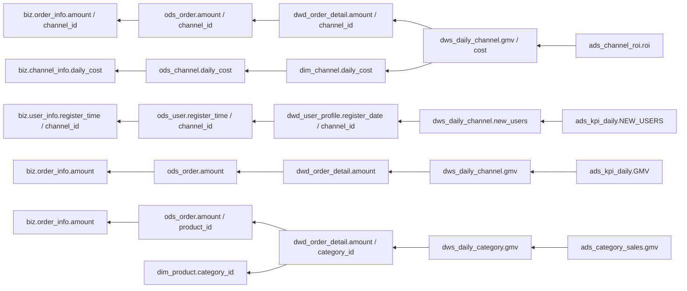

# 字段血缘 · ADS → ODS → biz（D-33）

> 每条 ADS 指标字段反查至 DWS/DWD/ODS/biz 四级源字段；用正则辅助提取表依赖 + 人工核对，
> 不追求全自动 SQL 解析器。口径唯一权威为架构 v1.1 §6.3 与 `metrics.yml`。

## 血缘总图

## 12 指标逐条反查

| 编号 | 指标 | ADS 落点 | 反查链路（ADS ← DWS ← DWD ← ODS ← biz） |
|---|---|---|---|
| M01 | NEW_USERS | `ads_kpi_daily.kpi_value` | `ads_kpi_daily` ← `dws_daily_channel.new_users` ← `dwd_user_profile.register_date/user_id` ← `ods_user.register_time` ← `biz.user_info.register_time` |
| M02 | GMV | `ads_kpi_daily.kpi_value` | `ads_kpi_daily` ← `dws_daily_channel.gmv` ← `dwd_order_detail.amount/order_status` ← `ods_order.amount/status` ← `biz.order_info.amount/status` |
| M03 | REFUND_RATE | `ads_kpi_daily.kpi_value` | `ads_kpi_daily` ← `dws_daily_channel.refund_orders/paid_orders` ← `dwd_order_detail.is_refund/order_status` ← `ods_order.status` ← `biz.order_info.status` |
| M04 | CHANNEL_ROI | `ads_channel_roi.roi` | `ads_channel_roi` ← `dws_daily_channel.gmv/cost` ← `dwd_order_detail.amount/channel_id` + `dim_channel.daily_cost` ← `ods_order.amount/channel_id` + `ods_channel.daily_cost` ← `biz.order_info` + `biz.channel_info.daily_cost` |
| M05 | ORDER_CNT | `ads_channel_daily.orders` | `ads_channel_daily` ← `dws_daily_channel.orders` ← `dwd_order_detail.order_no` ← `ods_order.order_no` ← `biz.order_info.order_no` |
| M06 | PAID_ORDER_CNT | `ads_channel_daily.paid_orders` | `ads_channel_daily` ← `dws_daily_channel.paid_orders` ← `dwd_order_detail.order_status` ← `ods_order.status` ← `biz.order_info.status` |
| M07 | AOV | `ads_channel_daily.aov` | `ads_channel_daily` ← `dws_daily_channel.gmv/paid_orders` ← `dwd_order_detail.amount/order_status` ← `ods_order.amount/status` ← `biz.order_info` |
| M08 | REFUND_ORDER_CNT | `ads_channel_daily.refund_orders` | `ads_channel_daily` ← `dws_daily_channel.refund_orders` ← `dwd_order_detail.is_refund` ← `ods_order.status` ← `biz.order_info.status` |
| M09 | REFUND_AMOUNT | `ads_channel_daily.refund_amount` | `ads_channel_daily` ← `dws_daily_channel.refund_amount` ← `dwd_order_detail.amount/is_refund` ← `ods_order.amount/status` ← `biz.order_info` |
| M10 | CHANNEL_NEW_USERS | `ads_channel_daily.new_users` | `ads_channel_daily` ← `dws_daily_channel.new_users` ← `dwd_user_profile.channel_id/register_date` ← `ods_user.channel_id/register_time` ← `biz.user_info.channel_id/register_time` |
| M11 | CAC | `ads_channel_roi.cac` | `ads_channel_roi` ← `dws_daily_channel.cost/new_users` ← `dim_channel.daily_cost` + `dwd_user_profile.register_date` ← `ods_channel.daily_cost` + `ods_user.register_time` ← `biz.channel_info.daily_cost` + `biz.user_info` |
| M12 | CATEGORY_GMV | `ads_category_sales.gmv` | `ads_category_sales` ← `dws_daily_category.gmv` ← `dwd_order_detail.amount/category_id` ← `ods_order.amount/product_id` ← `biz.order_info.amount` + `dim_product.category_id` |

## 核对说明

- 12 条指标全部有 ADS 落点（评审 P1-04 已补 `ads_channel_daily.aov/refund_amount`、`ads_channel_roi.cac`）。
- 维表 `dim_channel(channel_id=0)`、`dim_user(user_id=-1)` 为哨兵，空渠道/孤儿订单不丢单，归入 unknown。
- 金额类链路全程 `DECIMAL`，不用浮点算指标；除零用 `NULLIF` 保护，结果置 0 或 NULL 按口径。
